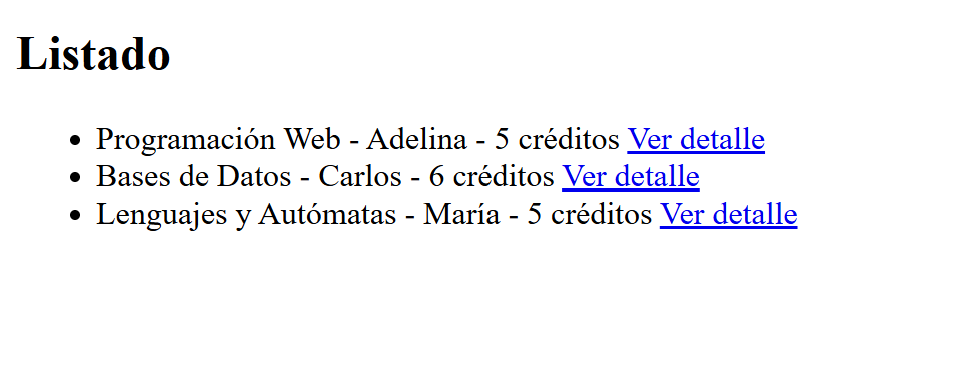
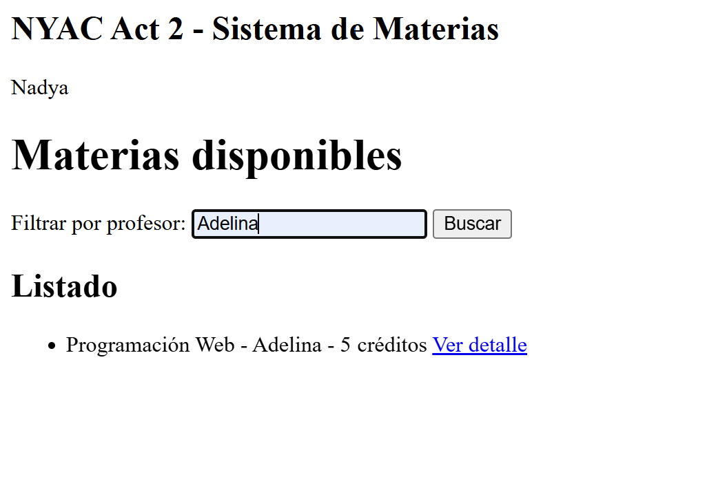
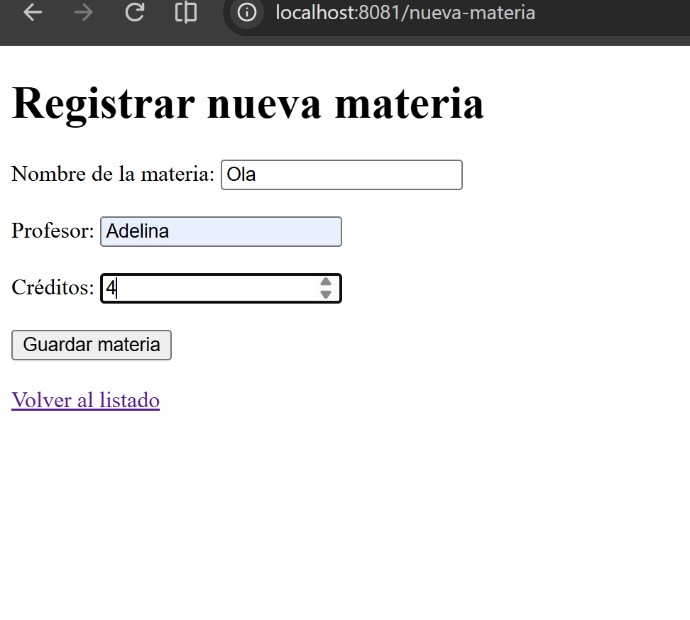
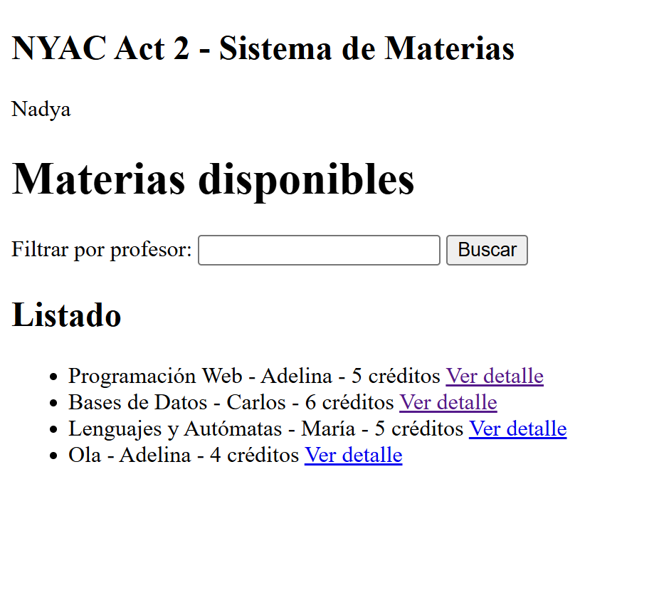
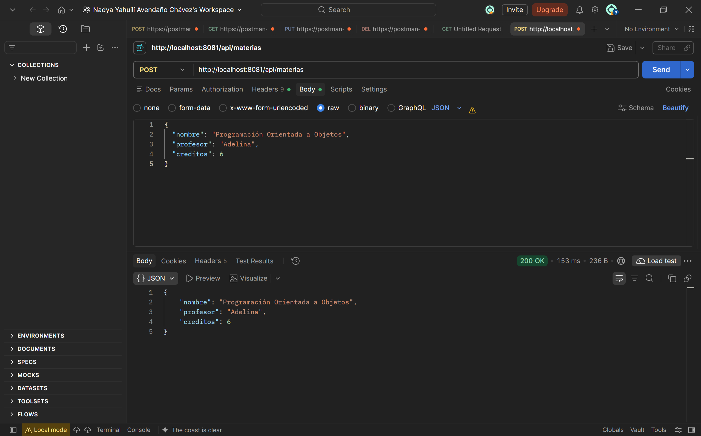
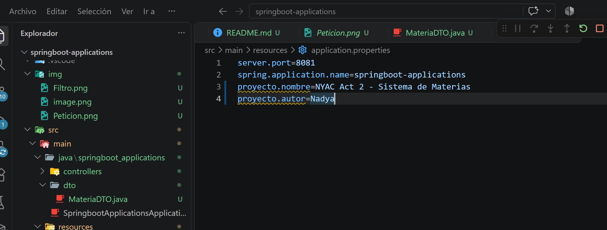

# Act2 - Spring MVC: Vistas con Thymeleaf, DTOs y Manejo de Peticiones

## Links

[GitHub - NYACact2_t4](https://github.com/yailivach91-ctrl/NYACact2_t4)


## Descripción del proyecto

Este proyecto consiste en una aplicación desarrollada con Spring Boot que implementa el patrón Spring MVC, utiliza vistas dinámicas con Thymeleaf, DTOs para el manejo de datos y diferentes tipos de peticiones HTTP.

El sistema permite visualizar materias, filtrar por profesor, registrar nuevas materias y recibir información mediante un servicio REST.

## Tecnologías utilizadas

- Java 17
- Spring Boot
- Spring MVC
- Thymeleaf
- Maven
- HTML
- Git y GitHub
- Postman

## Funcionalidades implementadas

### 1. Listado de materias
Se muestra una lista de materias utilizando Thymeleaf y el atributo `th:each`.

Ruta: `/materias-vista`

### 2. Filtro por profesor
Se utiliza `@RequestParam` para recibir el nombre del profesor y filtrar las materias.

Ejemplo: `/materias-vista?profesor=Adelina`

### 3. Detalle de materia
Se utiliza `@PathVariable` para recibir el índice de la materia y mostrar su información.

Ruta: `/materias-vista/{indice}`

### 4. Registro de materias
Se implementa un formulario con Thymeleaf y `th:object`, utilizando `@ModelAttribute` para recibir los datos y registrar una nueva materia.

Ruta del formulario: `/nueva-materia`

### 5. Uso de DTO
Se creó la clase `MateriaDTO`, que contiene los atributos:

- nombre
- profesor
- creditos

Esta clase permite transportar los datos de las materias entre las diferentes capas de la aplicación.

### 6. Configuración con @Value
Se utilizan propiedades definidas en `application.properties` para mostrar información del proyecto en la vista.

### 7. Servicio REST
Se implementó un endpoint POST que recibe un objeto `MateriaDTO` mediante JSON y devuelve la información recibida.

Ruta: `/api/materias`

## Evidencias del funcionamiento

Agregar las capturas de pantalla correspondientes:

1. **Listado de materias:** 

2. **Filtro por profesor:** captura del resultado de una búsqueda.

3. **Formulario:** 

4. **Registro de materia:** 

5. **Petición REST:** 

6. **Configuración del proyecto:** 



## Ejecución del proyecto

Para ejecutar el proyecto localmente:

```bash
./mvnw spring-boot:run
```

En Windows:

```powershell
.\mvnw.cmd spring-boot:run
```

La aplicación estará disponible en:

`http://localhost:8081`

## Repositorio

[GitHub - NYACact2_t4](https://github.com/yailivach91-ctrl/NYACact2_t4)

## Conclusión

Durante esta actividad se aprendió a utilizar Spring MVC para desarrollar aplicaciones web, integrar vistas dinámicas con Thymeleaf, transportar información mediante DTOs y manejar peticiones HTTP utilizando anotaciones como `@RequestParam`, `@PathVariable` y `@ModelAttribute`. También se implementó un servicio REST para recibir y devolver información en formato JSON.